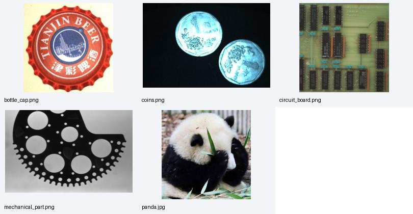

# 机器视觉基础实验：见习队员实践手册

本实验包供见习队员使用，通过九个实验学习图像读写、色彩处理、融合、直方图、形态学、滤波和边缘提取。使用 **VS Code + Jupyter + Python OpenCV**，建议 Python **3.11 或 3.12**。

图片、操作步骤、原理说明、示例代码和练习均已随包提供，可直接按顺序学习。首次安装依赖需要联网；安装完成后，全部实验可使用本地图片运行。



## 作业：一次提交

学习后完成三个小任务：**水平翻转、颜色调整、任选一种滤波**。通过一个 PR 提交三张对比图和三句说明，无需提交 Notebook 或代码。实验三、四、八末尾提供作业图片导出单元格。

- [作业要求与完成标准](assignments/README.md)
- [PR 提交步骤](CONTRIBUTING.md)
- [三句说明模板](assignments/submission_template.md)

其余练习和思考题供学习使用，不需要额外提交。

## 1. 建立环境

在 VS Code 中选择“文件 → 打开文件夹”，打开仓库中的 **02 机器视觉/lab** 文件夹，然后打开终端。不要只打开某一个 `.ipynb` 文件。

macOS / Linux：

```bash
python3 -m venv .venv
source .venv/bin/activate
python -m pip install -r requirements.txt
```

Windows PowerShell（直接调用环境内 Python，无需调整脚本执行策略）：

```powershell
py -3.12 -m venv .venv
.\.venv\Scripts\python.exe -m pip install -r requirements.txt
```

安装 VS Code 扩展 **Python** 和 **Jupyter**（项目已提供扩展推荐）。打开 Notebook 后，在右上角“选择内核 → Python 环境”中选 `.venv`；必要时手动定位 `.venv/bin/python`（Windows 为 `.venv\Scripts\python.exe`）。终端里的 Python 与 Notebook 内核可能不同，以 Notebook 实际输出的解释器路径为准。

## 2. 运行实验

1. 打开相应实验的 Notebook。
2. 选择 `.venv` 内核，点击“全部运行”。
3. 修改参数后再次运行相关单元格；检查完整流程时使用“重启内核并全部运行”。
4. 在 Notebook 末尾记录参数、现象与结论；保存文件。

也可使用独立 JupyterLab，在 lab 目录执行：

```bash
# macOS / Linux，已激活 .venv
python -m jupyterlab
```

Windows：

```powershell
.\.venv\Scripts\python.exe -m jupyterlab
```

本项目用 Matplotlib 在单元格内显示图像。依赖选用 `opencv-python-headless`，不依赖弹窗显示。若已有其他 OpenCV Python 包，建议新建 `.venv`，避免多个发行包共享 `cv2`。`requirements.txt` 给出兼容范围；实际验证版本见 `outputs/verification.json`。

## 3. 实验目录

| 实验 | Notebook | 内容 | 主要素材 |
|---|---|---|---|
| 一 | [lab01](lab01_install_opencv/lab01.ipynb) | 安装、版本验证与基本计算 | 瓶盖、色带 |
| 二 | [lab02](lab02_vscode_jupyter/lab02.ipynb) | VS Code、内核、图片路径 | 瓶盖 |
| 三 | [lab03](lab03_image_io/lab03.ipynb) | 读图、显示、翻转、保存 | 硬币、熊猫 |
| 四 | [lab04](lab04_color_adjustment/lab04.ipynb) | 通道、量化、色彩调整 | 瓶盖、熊猫 |
| 五 | [lab05](lab05_image_blending/lab05.ipynb) | ROI、加权及单通道融合 | 熊猫底图与瓶盖叠加图 |
| 六 | [lab06](lab06_histogram/lab06.ipynb) | 灰度、彩色与三维直方图 | 瓶盖 |
| 七 | [lab07](lab07_morphology/lab07.ipynb) | 腐蚀、膨胀、开闭运算 | 电路板、机械零件 |
| 八 | [lab08](lab08_filtering/lab08.ipynb) | 均值、高斯、中值、高频增强 | 瓶盖、电路板 |
| 九 | [lab09](lab09_edge_detection/lab09.ipynb) | Sobel、方向梯度、阈值 | 机械零件、熊猫 |

建议先完成实验一、二，确认环境和内核可用，再依次进行实验三至九。每个 Notebook 均包含实验目的、原理、分步操作、结果展示、参数练习和记录区。每张图片的用途见 [素材用途表](assets/README.md)。

## 4. 文件夹结构

```text
lab/
├── README.md
├── requirements.txt
├── .gitignore
├── CONTRIBUTING.md             # 一次作业的 PR 提交步骤
├── assignments/                # 作业要求与说明模板
├── submissions/                # 队员按 GitHub 用户名建立提交目录
├── .vscode/                    # 扩展推荐与编辑器配置
├── assets/
│   ├── README.md               # 图片用途与使用说明
│   ├── manifest.json           # 图片清单与使用实验
│   ├── contact_sheet.jpg       # 素材总览
│   ├── pdf/                    # 基础实验图片，共 4 张
│   ├── user/panda.jpg          # 熊猫照片
│   └── generated/              # 实验八生成的噪声素材
├── common/io.py                # 读图、保存与显示；算法保留在 Notebook 中
├── lab01_install_opencv/
├── lab02_vscode_jupyter/
├── lab03_image_io/
├── lab04_color_adjustment/
├── lab05_image_blending/
├── lab06_histogram/
├── lab07_morphology/
├── lab08_filtering/
├── lab09_edge_detection/        # 每个实验目录均含 README.md 和 labXX.ipynb
├── outputs/                    # 各实验结果、CSV/NPY 和验证记录
└── tools/verify_notebooks.py    # 从实验目录和项目根目录验证可运行性
```

不要移动或单独复制 Notebook；请复制整个 `lab/`，保留相对结构。图片的中文路径读写已作兼容处理。公共代码只处理路径、图片读写和显示，核心算法都可在实验单元格中查看。

## 5. 重新验证

安装依赖后在 lab 目录运行：

```bash
python tools/verify_notebooks.py
```

Windows 可用 `.\.venv\Scripts\python.exe tools/verify_notebooks.py`。该命令在每个实验目录中启动独立内核，并额外从 lab 根目录验证实验三；会刷新 Notebook 输出和结果图，写入验证记录。首次启动 Jupyter 或内核时，请使用本项目虚拟环境。

常见问题：`No module named cv2` 多为内核未选对或依赖没装进该环境；找不到图片时，请确认打开的是完整 lab 文件夹，且终端工作目录位于 lab 或其实验子目录。
