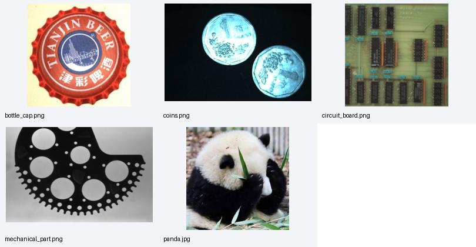

# 实验图片与用途

全部实验图片已包含在本目录，无需另行下载。下表说明每张图在哪些实验中使用、需要观察什么。路径相对于 `assets/`，请保持文件夹结构，运行 Notebook 时会自动定位图片。

| 图片 | 使用实验 | 操作与观察目标 |
|---|---|---|
| `pdf/bottle_cap.png` | 一、二、四、五、六、八 | 验证图像读取；分离颜色通道、减少颜色等级；叠加到熊猫照片；统计灰度与颜色分布；添加噪声并比较去噪和锐化效果 |
| `pdf/coins.png` | 三 | 读取、显示、水平与垂直翻转；保存为 PNG 后重新读取，检查像素是否一致 |
| `pdf/circuit_board.png` | 七、八 | 观察灰度腐蚀与膨胀如何改变暗色元件边界；比较高斯和中值滤波对细节的影响 |
| `pdf/mechanical_part.png` | 七、九 | 把零件转换为白色前景，观察腐蚀、膨胀、开闭运算；比较 Sobel 方向梯度和不同阈值的边缘结果 |
| `user/panda.jpg` | 三、四、五、九 | 翻转、颜色量化；作为图像融合底图；比较自然纹理与机械零件的边缘响应 |
| `generated/cap_gaussian_noise.png` | 八 | 由瓶盖图添加高斯噪声生成，用于观察滤波效果 |
| `generated/cap_salt_pepper.png` | 八 | 由瓶盖图添加椒盐噪声生成，用于比较均值、高斯和中值滤波 |
| `contact_sheet.jpg` | 图片预览 | 查看本目录中的五张基础素材，不参与图像计算 |

## 更换图片练习

实验五可尝试将底图改为电路板；实验六、七、八可尝试将输入改为熊猫。这些属于可选练习，需要修改输入路径，检查图像尺寸和通道数，再运行后续单元格。

## 原图与实验结果

`pdf/` 和 `user/` 中的图片作为输入保留。实验结果写入 `outputs/`；实验八生成的噪声图写入 `generated/`。重新运行会覆盖同名结果，不会覆盖基础素材。实验八直接处理生成的噪声数组，同时把它们保存为图片，便于查看和记录。
